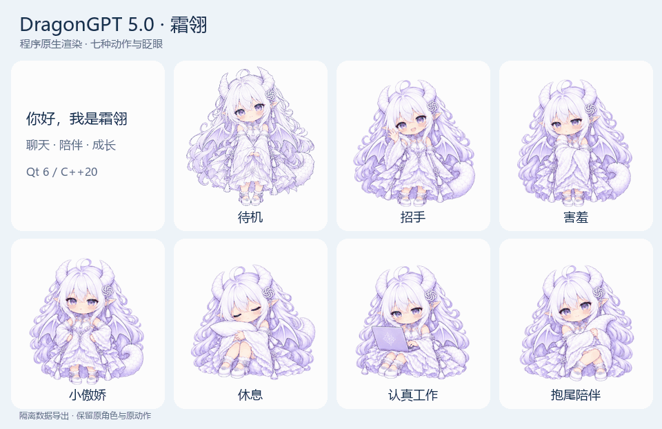
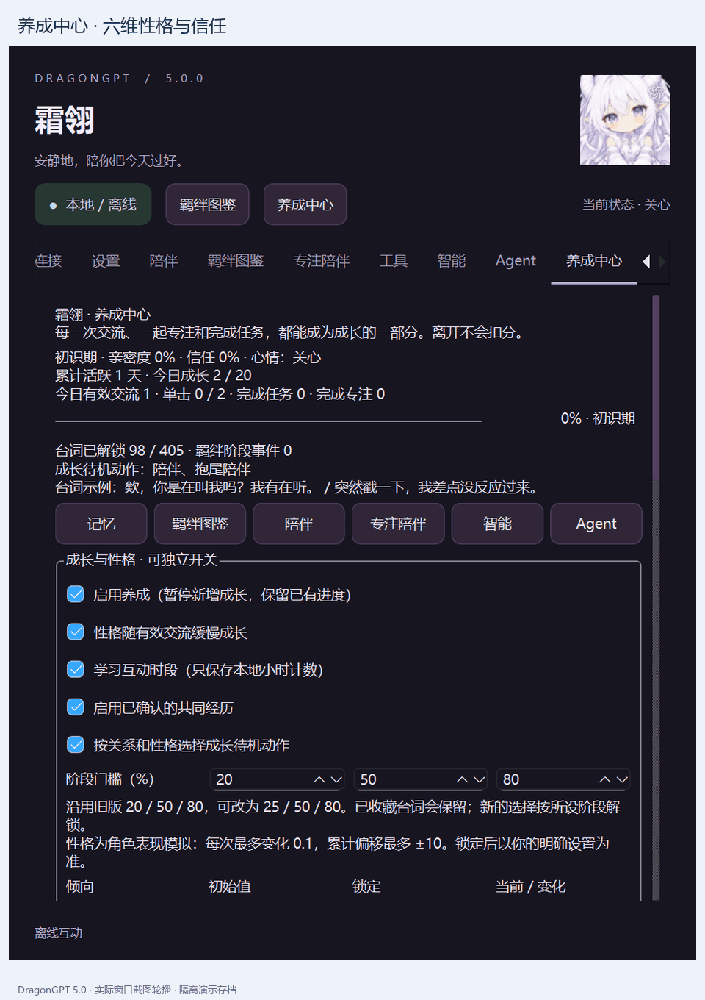
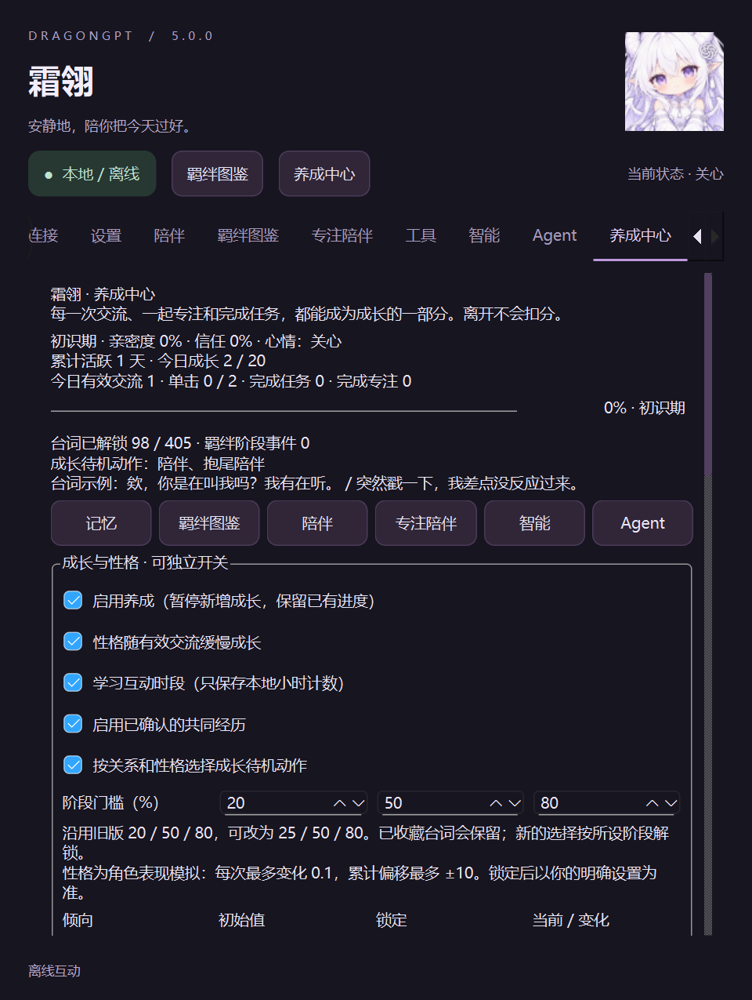

# DragonGPT · 霜翎

**Windows 桌面上的 Q 版白龙娘伙伴，使用 Qt 6 / C++20 构建。**

陪你聊天、专注和完成任务，记住经过确认的偏好与共同经历。5.0.0 加入养成中心，将亲密度、六维性格、信任、任务成长和主动陪伴连接起来。

[下载安装包](https://github.com/rye022/DragonGPT/releases/latest) · [完整使用手册](docs/DRAGONGPT_5_MANUAL.md) · [养成指南](docs/DRAGONGPT_5_GUIDE.md) · [版本说明](docs/RELEASE_v5.0.0.md)

## 动图演示

当前程序原生渲染器导出的实际动作帧，展示待机、招手、害羞、休息、工作和抱尾等动作，保留原版角色资产：



实际功能窗口导览（隔离演示存档，按页面轮播）：





## 下载安装

支持 **Windows 10 1809 / Windows 11，x64**。基本运行库随包提供，普通使用无需安装 Qt、编译器或 Python。

| 下载文件 | 用途 |
| --- | --- |
| [DragonGPT-Setup-v5.0.0-win-x64.exe](https://github.com/rye022/DragonGPT/releases/download/v5.0.0/DragonGPT-Setup-v5.0.0-win-x64.exe) | 安装版，提供开始菜单及可选桌面/开机启动快捷方式 |
| [DragonGPT-v5.0.0-Windows-x64.zip](https://github.com/rye022/DragonGPT/releases/download/v5.0.0/DragonGPT-v5.0.0-Windows-x64.zip) | 便携版，完整解压后运行 DragonGPT.exe |
| [DragonGPT-v5.0.0-source.zip](https://github.com/rye022/DragonGPT/releases/download/v5.0.0/DragonGPT-v5.0.0-source.zip) | 项目源码 |
| [SHA256SUMS.txt](https://github.com/rye022/DragonGPT/releases/download/v5.0.0/SHA256SUMS.txt) | 发布附件的 SHA-256 校验值 |

安装版默认安装到 `%LOCALAPPDATA%\Programs\DragonGPT`，无需管理员权限。安装包尚未进行代码签名。便携版也可运行 `Start-Desktop.cmd` 仅显示桌宠。

升级前退出旧程序并备份用户数据。默认存档为 `%LOCALAPPDATA%\DragonGPT\UserData`；已有便携目录中的 `data/memory.sqlite` 时继续使用该目录。安装到新目录不会自动导入另一便携目录的存档，可使用 `--data-dir "原数据目录"` 指定。5.0 的 schema 8 自动创建升级前备份，旧版不能直接打开新存档；[恢复步骤](docs/DRAGONGPT_5_GUIDE.md#存档升级和恢复)见指南。

## 第一次使用

1. 启动后双击桌宠打开陪伴窗口；右键菜单可切换动作、大小、半身显示和退出。
2. 在「连接」页填写自己的 DeepSeek 接口设置和 API Key，保存后开始在线聊天。未配置在线服务时仍可使用本地规则对话、桌宠和本地工具。
3. 在「语音」页设置朗读引擎、接口和音色。云端 TTS、云端语音识别需要各自的权限和密钥，费用由对应服务收取。
4. 在「陪伴」页调整主动频率、静默时段和勿扰，在「养成中心」查看成长、设置性格及确认共同经历。
5. 需要处理文件时进入「Agent」，选择模式和授权目录，检查具体请求，再逐项批准需要授权的操作。

API Key 使用 Windows DPAPI 本地保护。发布包不包含作者的密钥、聊天记录、存档、音色配置或 Python 环境。

## 功能与简明手册

| 功能 | 怎么使用 |
| --- | --- |
| 桌宠与动作 | 拖动移动；单击触发当前动作台词；双击打开窗口；右键设置动作、半身、尺寸和显示方式 |
| 对话与情绪 | 「对话」输入文字或确认语音草稿；本地情绪、口型与所选 TTS 联动 |
| 长期记忆 | 「记忆」中检索、编辑、删除、导入/导出；也可说「记住：…」「叫我…」。待确认建议不会直接成为事实 |
| 主动陪伴 | 「陪伴」设置频率、勿扰与静默；沿用专注和全屏保护；关闭功能不扣成长 |
| 羁绊图鉴 | 查看各关系阶段的解锁台词及收听记录，使用所选音色试听 |
| 专注与喝水 | 「专注」设置番茄钟、暂停/继续、喝水提醒、延后和今日关闭 |
| 待办与工具 | 「工具」管理待办、提醒、统计、健康及文件整理；整理先预览，再执行或撤销 |
| 剪贴板 | 按授权开启历史与悬浮入口，选择内容后再发送 |
| 读屏理解 | 「智能」中按需截图、OCR、模型分析，默认关闭；敏感窗口有保护 |
| Agent | A 普通聊天 / B Agent 自动 / C 高级开发；目录授权仅本次会话有效，外部访问和修改等操作保留审批 |
| 语音识别 | SAPI、本地 faster-whisper、云端兼容接口可选；识别稿可编辑、确认或丢弃，独立于 TTS |
| 5.0 养成中心 | 六维性格、信任、成长事件、任务奖励、已确认共同经历、时段学习和受限只读探索 |

养成不把挂机时间当成陪伴。每日共享 20 XP，亲密度满值后仍可有限更新性格、信任和时段习惯。各项成长及自主功能可独立关闭。共同经历需要确认；只读探索需要提交目标并经过现有 Agent 审批。

普通聊天为默认模式。网页、文件和模型输出不能授予权限。Agent 构建/测试预设会以当前用户权限执行项目代码，请先检查项目内容。

## 完整文档

- [5.0 完整使用手册](docs/DRAGONGPT_5_MANUAL.md)：安装、各页功能、Agent、语音、备份和故障排查。
- [5.0 养成系统指南](docs/DRAGONGPT_5_GUIDE.md)：经验规则、性格、信任、共同经历、探索与恢复。
- [架构说明](docs/DRAGONGPT_5_ARCHITECTURE.md)、[开发测试报告](docs/DRAGONGPT_5_TEST_REPORT.md)、[发布验证记录](docs/RELEASE_v5.0.0_VALIDATION.md)。
- [聊天接口配置](docs/connection.md)、[语音配置](docs/voice.md)、[更新记录](CHANGELOG.md)、[第三方许可说明](THIRD_PARTY.md)。

## 可选依赖

Agent 的文档处理、浏览器工具和本地 ASR 需要另行准备 Python 依赖。模型权重与运行环境没有随安装包分发，在程序或源码目录手动运行：

```powershell
python agent/prepare.py --with-asr --model base
```

该操作会安装依赖并下载本地识别模型。不需要本地模型时省略 `--model base`；不需要 ASR 时省略 `--with-asr`。也可在界面填写已有 Python 和模型目录。浏览器工具依赖本机 Edge。离线 TTS 的独立准备步骤见语音文档。

## 从源码构建

需要 Qt 6.5+（本次使用 6.8.3）、MinGW C++20、CMake 3.24+、Ninja；启用测试还需 Python 3。Qt 组件：Core、Gui、Widgets、Sql、Network、Multimedia、WebSockets、Concurrent、Test。

```powershell
./build.ps1 -QtRoot 'C:/Qt/6.8.3/mingw_64' -CompilerDir 'C:/Qt/Tools/mingw1310_64/bin' -BuildDir './build' -Package
python package_release.py
./scripts/build-installer.ps1 -Iscc 'Inno Setup 6/ISCC.exe 的完整路径' -OutputDir './outputs'
```

构建脚本执行配置、编译、CTest 和运行库部署。安装器使用 Inno Setup 6；打包过滤用户数据、凭据、配置、模型、缓存和本机环境。

## 当前验证范围

Windows 本机完整 CTest、隔离存档及运行包测试见发布验证记录。真实云端计费与授权、真人麦克风效果、多显示器/不同 DPI、新系统可选依赖兼容性及 24 小时以上稳定性仍需实际环境验证。

角色使用 Qt 原生精灵与局部网格动画，当前未绑定 Cubism Live2D 模型。性格成长使用可解释的本地规则。源码公开供查看；项目尚未授予开源许可，第三方组件遵循各自许可。
