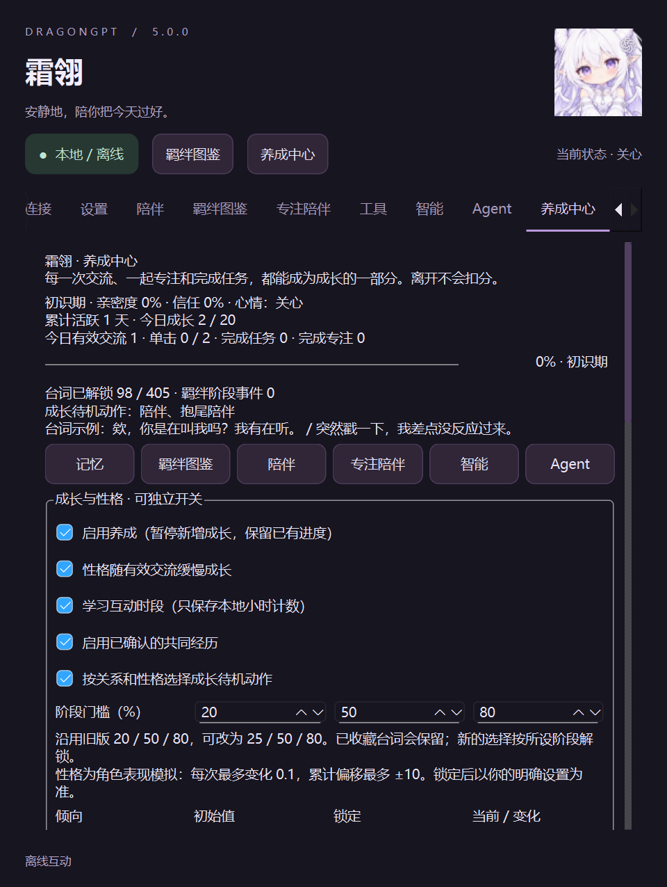

# DragonGPT 5.0 养成系统指南

在原陪伴窗口最右侧打开「养成中心」。对话、记忆、音色、图鉴、专注和Agent保留在原来的位置；角色仍为原版Q版白龙娘。

也可使用窗口顶部的「养成中心」按钮。以下为隔离测试存档的实际窗口截图，数值不代表你的用户存档：

## 怎样成长

亲密度仍使用原有经验和实际活跃天数计算，不把挂机时间算成陪伴，也不因离开而扣分。每日共享20 XP：有效交流2点；单击1点且每天最多两次；合格专注4点；完成待办或有真实工具成功的Agent任务2点。专注奖励沿用至少15分钟、每天最多四轮和唯一结算规则。

重复交流去重、单击90秒冷却、交流30秒冷却、专注与任务各25分钟冷却继续生效。任务失败、取消和被拒绝的操作不增加任务奖励；任务结果仍可作为普通交流保存。统计中的交流/任务次数表示实际计入成长的事件，并非所有点击或所有任务。

沿用旧存档的20/50/80阶段门槛，也可在养成中心改成25/50/80或其他严格递增的1–99整数。更改门槛不修改经验、不伪造天数，已解锁收藏保留；新的台词选择按当前门槛换算。四阶段都有多条现有台词，不新建第二套台词库。

信任只随计入成长的交流、专注和任务累积，单击不增加信任。旧版没有这个数值，因此迁移从0开始，不补造历史。

亲密度满值后，性格、信任与互动时段仍可继续变化：每天最多10次有效非单击事件，继续使用去重和冷却，记录为0 XP，不突破600 XP上限。这样满羁绊后仍可形成新的互动习惯。

## 性格和动作

活泼、傲娇、好奇、关怀、主动、幽默六个维度有可编辑初始值。有效互动中的有限本地关键词或任务类型每次最多影响相应维度0.1，累计偏移最多±10。系统记录原因类别，不复制原始对话。

勾选「锁定」后，该维度使用你的初始设置，成长不覆盖它。「重置性格成长偏移」只清零偏移，保留初始值、锁定状态、经验和经历。修改后点击「保存养成设置」。

倾向影响本地台词选择权重、聊天上下文和已解锁的兼容待机动作。情绪仍由已有EmotionEngine决定；难过、困倦、专注和主动语音等优先级保留。成长待机逐步加入开心招手、害羞和认真工作；原有手动七种动作仍可使用。

这是角色表现模拟，不代表真实意识。不会因为用户离开、拒绝建议或关闭功能而惩罚用户。

## 自主生活与探索

自主决策使用现有唯一主动调度器和已有活动/情境服务，不增加后台截图。沿用冷却、每日上限、静音、勿扰、专注/全屏保护及忽略后降低频率，新增滚动一小时上限。会议等情境保护需要用户在「智能」中启用本地情境判断；未授权时不会暗中读取窗口标题。养成中心显示最近一次决策原因。

互动时段学习只保存在本地的24个小时计数；至少有20次有效记录后，避开明显不常互动的时段。可独立关闭或清空。不会读取键盘内容、网站或自行扩大电脑监测权限。

待办、共同经历、探索建议默认关闭，分别允许后才参与本地决策。待办只报告数量；经历只邀请用户在聊天回顾，不主动读出原文。喝水、休息继续由现有专注服务调度，避免重复提醒。

探索开关允许提出探索建议，用户填写具体目标后点击「到Agent审阅只读探索目标」。此时只准备目标，不发起网络。检查模式和工作区后点击Agent执行，才会调用现有模型。模型及网页操作可能产生费用。

只读探索执行层只接受文件列举/读取/检索/摘要/元数据、网页读取/搜索和已有健康/统计/待办只读工具。网页访问仍逐项批准；禁用文件修改、终端、浏览器交互和对外发布。关闭探索开关会取消正在运行的探索。普通Agent功能及原来的审批仍保留。

## 三层记忆和隐私

- 短期：原有最近200条消息与临时上下文。
- 长期：原有记忆页，继续使用来源、标签、重要度、去重、检索、纠正、删除和导入/导出；待确认建议不当作事实。
- 成长：同一LifeState内的关系、性格、解锁、限量成长事件和已确认共同经历。

在共同经历输入框填写简短事实，点击「确认保存经历」才进入成长记忆。支持更正和删除；重复或明显敏感内容拒绝保存。查询相关经历或明确询问回忆时，最多提供三条已确认记录作为数据。关闭经历功能立即停止回忆注入，删除立即生效。

自动任务记录只保存「完成任务」这类类别，不自动保存文件内容、任务标题或模型猜测。音色偏好仍由语音设置管理。

成长事件最多200条，面板显示最近40条；共同经历最多100条。可导出成长/经历JSON或单独清空成长事件和时段统计。导出包含已确认经历，请自行保管。原记忆导入/导出仍在「记忆」页。

养成、性格、时段学习、经历、成长待机、自主决策和各类建议均有独立开关。关闭养成暂停新增经验和性格成长，保留已有进度，原聊天、情绪和语音继续工作。旧的主动互动总开关仍在「陪伴」。

## 存档升级和恢复

数据库升级为schema 8。首次打开旧数据库前自动创建同目录的 *.pre-v8-时间.sqlite，迁移在事务内完成并运行integrity_check。既有经验、活跃天数、记忆、收藏与情绪保持，新增字段使用默认值。

新字段位于companion_life.state的growth_v5中。6维初始值与锁定、事件和小时计数均在此记录，不新建数据库或另开定时器。主动设置仍在companionship.ini。

旧版程序会拒绝schema 8，防止不认识的新字段在写回时丢失。需要回退时，先退出程序，再用对应旧版及升级前备份；不要直接用旧版覆盖新存档。现有 --restore-backup 和 --verify-data 入口保留。正式安装前应另行备份完整用户数据、配置和凭据。

## 验证边界

本机自动化、截图和性能结果见测试报告。云端计费、真人麦克风、全屏游戏/真实会议、多显示器DPI和24小时以上运行不能由局部自动测试替代。开关、短期压力和模拟时钟通过也不等同于这些场景已通过。

后续可扩展：让用户为已批准的特定只读来源设置定期探索授权；增加成长事件的筛选和来源关联；在同一渲染器内补充经视觉验收的动作资源。当前不默认启用这些权限。
