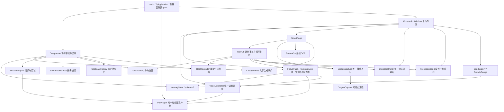
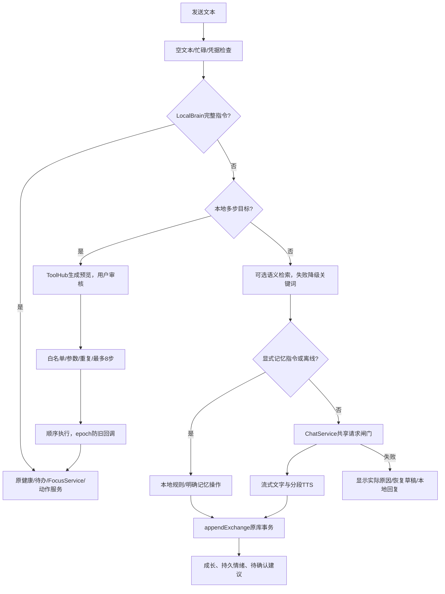
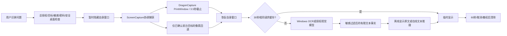
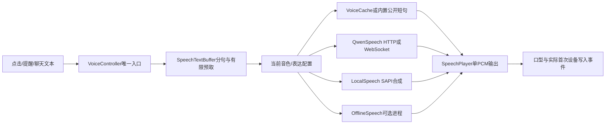

# DragonGPT 3.0 模块依赖关系

基于2026-10-26—27实际源码、对象所有权、信号连接和回归测试。这里的箭头表示运行时调用/事件；完整静态include边见[audit/source-index.json](audit/source-index.json)，不把include边误称为所有实际调用。

## 1. 主要所有权与服务边界

所有界面状态、角色修改和主要Qt SQL连接在GUI线程上串行处理。HealthMonitor、文件哈希/移动、系统活动探针、音频设备查询、SAPI合成通过QtConcurrent运行；它们用QFutureWatcher交回结果。OCR、PrintWindow、可选语义和离线语音通过QProcess隔离。并不意味着每个SQL调用都无阻塞：SQLite busy_timeout、备份、导入和关键词检索仍可能占用GUI线程，见风险。

## 2. 聊天、工具与记忆调用

Companion和SmartPage有普通聊天、屏幕分析、规划三个ChatService对象，它们复用同一实现与GUI线程内requestOwner闸门，一次仅一个DeepSeek生成请求；它们的上下文/取消生命周期不同，属于合理复用。`/models`是独立认证发现，不是第二套生成器。TTS是另一协议和职责，允许和文字生成并行，语音输出仍只有一条播放器管线。

LocalBrain直接执行有限且确定的单指令，ToolHub审核多步目标，两者最终调用同一领域服务。没有把所有普通指令强制变成云端计划，也没有两个番茄钟。工具写待办现统一调用CompanionWindow::confirmTask→LocalTools::addTask，保留日期、优先级和过期/取消复核。

MemoryStore管理记忆、关系、收藏、用量、专注；LocalTools管理待办/每日统计，ClipboardHistory管理剪贴板，各用独立Qt SQL连接但写同一个SQLite文件。表职责分离，未另建“智能记忆库”。语义worker仅操作向量缓存，触发器和指纹防编辑/删除后旧向量复活。三个连接不宜改成跨线程共享连接。

## 3. 屏幕与语音流程

PrintWindow helper、原生像素回退、Windows OCR是一个按需工作流的不同环节，不是重复持续抓屏服务。ScreenCapture的1秒tracker只记句柄或按开关观察标题；智能页不另建截图轮询器。像素与OCR不默认入库，普通剪贴板分析进入正常聊天，两条隐私路径明确不同。

音色切换、取消和新回合终止旧输出；QwenSpeech generation、SpeechPlayer generation和ToolHub epoch分别负责各自生命周期，不能用一个全局锁代替。RealtimeClient与AudioDuplex保留在核心库，当前VoiceController无实例连接，不是第二套正在抢麦克风的后台通话。

## 4. 通知与角色优先级

| 域 | 产生/去重 | 展示边界 |
|---|---|---|
| 主动开场 | Companion单次计时；本地冷却/日上限/忽略退避 | 语音、输入、专注、隐藏、已有气泡、交互、敏感桌面时暂缓 |
| 待办/健康 | LocalTools notified；HealthMonitor持续阈值和30分冷却 | CompanionWindow队列；共享PetWidget占用判断，普通气泡/受保护动作期间等待 |
| 喝水 | FocusService waterPending、最少间隔、安静与专注策略 | 队列保留；普通气泡期间延后，语音/交互/隐藏/模态期间不取走 |
| 用户番茄阶段 | FocusService priority≥3，替换旧阶段事件 | 可覆盖普通气泡；语音/点击/拖动/隐藏/模态仍优先；避免短计时开始事件丢失 |
| 羁绊提示 | bondNoticeTimer | 等待专注、语音、聊天、气泡与保护动作结束 |

PetWidget::automaticAction是唯一动作选择器：拖动→点击捕获→交互动作→聆听→手动动作→专注阶段→播报/聊天→情绪/随机/自动休息。PetActions负责平滑权重，SpriteMotion负责原素材形变，EmotionEngine不另行播放动画。事件在同一GUI循环串行处理，共享可用性判断与领域优先级，无新增全局锁。

## 5. 定时器与资源预算

| 任务 | 周期/触发 | 作用与释放 |
|---|---|---|
| 角色帧 | 可见33ms | hide停、show复用；缓存原素材和混合帧 |
| 情绪到期 | 100ms | tick衰减，不是硬件/截图采集 |
| 本地SAPI事件 | 有聆听或原生朗读时25ms | 本次修为按需启动；空闲停；异步PCM合成不需要轮询 |
| 播放器 | 有输出时10ms | PCM写设备、口型、排空判断；stop释放sink |
| 语音缓冲 | 250ms/30ms预取检查 | 仅当前流；上限缓冲和代际取消 |
| 健康 | 5s | 单Future防重入；趋势≤120采样 |
| 活动探针 | FocusPage每5s | 额外锁屏/会话/开机时长；与硬件采样的idle用途不同 |
| 专注/待办/通知队列 | 每1s | 分别推进不同状态，非重复定时职责 |
| 专注落库 | 约5s或关键操作 | 原wellness_state检查点与唯一会话结算 |
| 窗口跟踪 | 每1s | 未授权仅句柄；授权才观察标题，不截图 |
| 主动开场 | 随机单次 | 活动重新排期，阻挡延后，不积压补播 |
| 剪贴板 | 原生事件+30ms去抖；清理60s | 仅一个dataChanged连接，复制自通知抑制 |
| 模型worker | 按需；空闲60s | 超时终止，不在启动时重复加载权重 |
| API/OCR/helper/工具 | 单次截止 | 各自取消/终止，不共用阻塞全局锁 |

多个计时器负责不同时间语义，不合并成一个每毫秒大轮询。健康与Focus的两次廉价GetLastInputInfo读取不是两套硬件采集：一条形成日统计，另一条参与锁屏/休眠恢复与喝水状态；粗暴合并会改变现有时间/恢复契约。后续若统一，应以独立活动服务和模拟时钟验证，不作为本次未经测量的性能提升。

## 6. 完整实现文件责任索引

| 文件（src/） | 主要责任 |
|---|---|
| main.cpp | 启动、数据目录、单实例、IPC、托盘、CLI、自检 |
| companion.cpp | 聊天编排、唯一主动计时、记忆背景、成长同步 |
| companion_window.cpp | 十页容器、聊天/设置/记忆/语音/连接/陪伴、统一通知展示 |
| smart_page.cpp | 屏幕流程、模型发现、任务UI、工具注册；不重复实现领域服务 |
| pet_widget.cpp / sprite_motion.cpp / pet_actions.cpp | 唯一角色视图、原素材形变、动作状态和平滑/轮换 |
| emotion_engine.cpp / companion_life.cpp | 情绪上下文/衰减；关系经验/配额/候选建议规则 |
| dialogue_engine.cpp / dialogue_catalog.h.in | 405台词资格、去重、加权与构建时资源目录 |
| growth_gauge.cpp / bond_gallery.cpp | 成长显示、收藏筛选与试听 |
| memory_store.cpp | schema7、记忆/关系/收藏/专注事务、备份/恢复、到期/导入 |
| semantic_memory.cpp | 本地ONNX进程协议、超时、降级 |
| chat_service.cpp / chat_settings.cpp / response_stream.cpp / api_errors.cpp | 模型传输与并发；代理/DPAPI；有界SSE解析；安全错误翻译 |
| voice_controller.cpp / speech_text_buffer.cpp / speech_expression.cpp | 单语音队列、分句、音色/情绪表达 |
| qwen_speech.cpp | 云端TTS协议、边界校验与SpeechPlayer设备输出 |
| local_speech.cpp / offline_speech.cpp | Windows识音/SAPI合成；可选本地模型与缓存 |
| voice_session.cpp / realtime_client.cpp / audio_duplex.cpp | 会话状态；未连接到普通用户入口的实时协议与PCM适配 |
| local_brain.cpp / task_parser.cpp / local_tools.cpp | 保守本地指令；自然日期解析；待办和每日统计 |
| tool_hub.cpp | 工具目录、计划校验、审核、顺序执行、有限重试和代际取消 |
| tools_page.cpp | 原待办编辑器、健康/总结/文件UI |
| focus_service.cpp / focus_page.cpp | 纯状态机/模拟时钟；真实系统事件和页面/提醒联动 |
| health_monitor.cpp | CPU/内存/PDH/NVML采样、趋势和负载提醒 |
| clipboard_history.cpp / clipboard_panel.cpp | 历史/过滤/保留；唯一监听与原生复制校验/布局 |
| file_organizer.cpp | 单层规则预览、全哈希、拒绝覆盖、撤销/失败回滚 |
| screen_capture.cpp / capture_helper.cpp / screen_ocr.cpp | 捕获授权与协调；阻塞隔离；本地OCR协议 |
| context_engine.cpp / desktop_hotkey.cpp | 本地情境滞后；透传Q观察与组合键注册 |
| diagnostics.cpp / latency_trace.h / privacy.h / types.h | 日志/崩溃；元数据时序；凭据启发式；公共数据类型 |

脚本和资源：`scripts/ocr.ps1`本地WinRT；`embedding/*`/`offline/*`显式准备与worker；`scripts/desktop_cleanup.ps1`仅按清单维护；`build.ps1`/`package_release.py`/`installer/*`/`install.ps1`/`uninstall.ps1`构建安装；`Verify-Blinks.ps1`/`Verify-Bond.ps1`辅助检查；`assets.qrc`/`assets/*`/`prompts/*`为固定资源。全部文件哈希和机械入口均在audit索引中。

## 7. 本次整合边界

合并待办审核UI；统一被动通知展示占用条件；复用记忆行映射并改为主键查询；修正重入取消与导入去重。未引入新调度框架、全局互斥锁、第二个记忆库或播放器，未删除现有正常功能或开发保留适配器。当前CompanionWindow与SmartPage仍承担较多UI编排，这是后续可渐进拆分的结构风险，不以大重构替代本次可验证修复。
